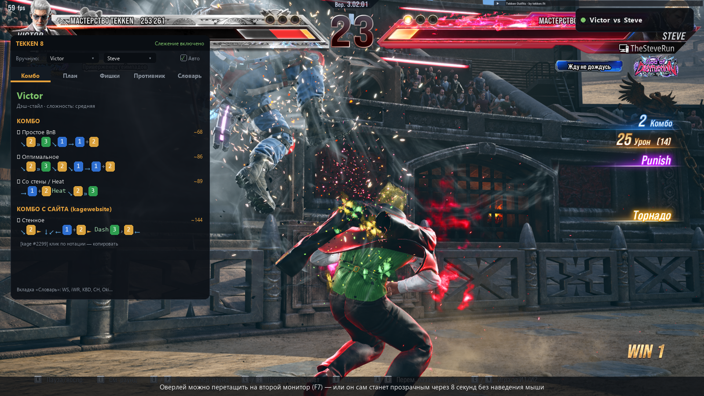

# Tekken 8 Assistant

Оверлей-помощник для Tekken 8: в реальном времени определяет вашего персонажа и персонажа противника по экрану и показывает комбо, план на игру, фишки и контрплей против оппонента.



> Панель можно перетащить на второй монитор (режим `F7` → «2-й монитор») — или она сама станет прозрачной через 8 секунд без наведения мыши.

## Возможности

- **Автоопределение персонажей** — скриншот + OCR (Tesseract) читают имена с HUD игры, 42 персонажа.
- **Комбо** — база комбо для каждого персонажа + свежие комбо с сайта tekken8combo (kagewebsite), клик по нотации копирует её в буфер.
- **Официальная нотация с иконками** — `d/f+2 ► f,f+3` отображается стрелками `↘ »` и цветными кнопками как в игре: 1 синяя, 2 жёлтая, 3 зелёная, 4 красная.
- **План / Фишки / Противник** — что делать в матче, чем наказывать оппонента, его опасные удары и слабости.
- **Словарь** — ~80 терминов и аббревиатур файтингов (WS, iWR, KBD, CH, Oki, BnB...).
- **3 режима отображения** — компактный бейдж (не мешает в бою), панель с вкладками, второй монитор. Панель сама затухает через 8 секунд без наведения мыши.
- **Автозапуск с игрой** — опциональный watcher: стартует ассистент при запуске Tekken 8 и закрывает после выхода.

## Установка (Windows)

### Вариант 1 — готовый exe (проще всего)

1. Скачайте `Tekken8Assistant.exe` со страницы [Releases](https://github.com/Hainox/tekken8-assistant/releases) и положите в любую папку — Python не нужен.
2. Для распознавания персонажей установите Tesseract-OCR (один раз):

```powershell
winget install UB-Mannheim.TesseractOCR
```

3. Запустите `Tekken8Assistant.exe`.

### Вариант 2 — из исходников

1. Установите [Python 3.11+](https://www.python.org/downloads/) (при установке отметьте *Add to PATH*).
2. Скачайте репозиторий и в его папке выполните:

```powershell
powershell -ExecutionPolicy Bypass -File install.ps1
```

Скрипт установит зависимости, при необходимости сам поставит Tesseract через winget и создаст ярлык **Tekken 8 Assistant** на рабочем столе. С ключом `-WithAutostart` дополнительно настроит автозапуск вместе с игрой:

```powershell
powershell -ExecutionPolicy Bypass -File install.ps1 -WithAutostart
```

Ручной вариант:

```powershell
pip install -r requirements.txt
python main.py
```

## Настройка

Все параметры — в `config.json`:

| Параметр | Описание |
|---|---|
| `monitor_index` | номер монитора с игрой (0, 1, 2...) |
| `poll_interval` | период опроса экрана, сек |
| `overlay_mode` | `compact` / `expanded` / `monitor` |
| `overlay_monitor_index` | монитор для режима «2-й монитор» |
| `use_kage_fetch` | подтягивать свежие комбо с сайта |
| `hotkey_*` | клавиши управления (см. ниже) |

## Управление

| Клавиша | Действие |
|---|---|
| `F7` | переключить режим (бейдж → панель → 2-й монитор) |
| `F8` | показать/скрыть оверлей |
| `F9` | пауза/возобновление слежения |

Клик по компактному бейджу разворачивает панель. Панель можно перетаскивать за заголовок.

## Как это работает

Программа делает скриншот верхней полосы HUD, OCR распознаёт имена персонажей, совпадение подтверждается несколько кадров подряд (защита от ложных срабатываний на экранах выбора/результатов). Для определённого персонажа подгружается база комбо и контрплей; для противника — его опасные удары и слабости.

## Тесты

```powershell
python -m pytest tests/ -q
```

## Дисклеймер

Проект не связан с Bandai Namco. Данные комбо частично берутся с открытого сайта tekken8combo.kagewebsite.com.
